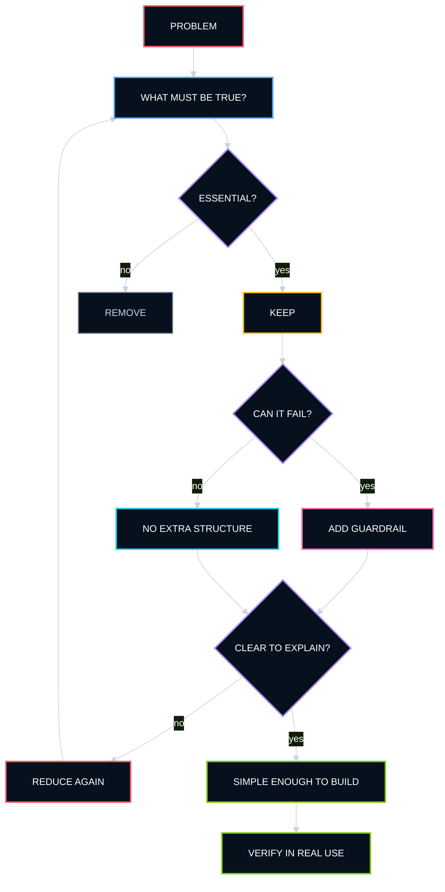
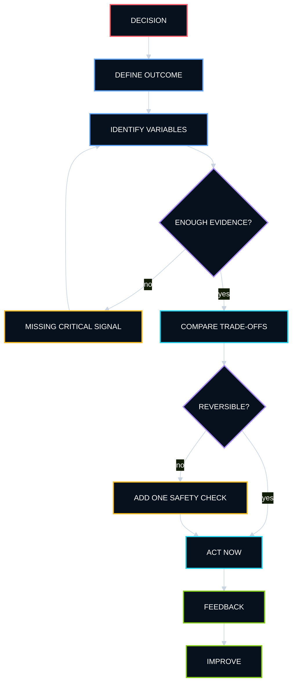

```mermaid
%%{init: {
  "theme": "base",
  "themeVariables": {
    "background": "#050816",
    "primaryColor": "#07111D",
    "primaryTextColor": "#FFFFFF",
    "primaryBorderColor": "#22D3EE",
    "lineColor": "#94A3B8",
    "secondaryColor": "#07111D",
    "secondaryTextColor": "#FFFFFF",
    "secondaryBorderColor": "#FF5F6D",
    "tertiaryColor": "#07111D",
    "tertiaryTextColor": "#FFFFFF",
    "tertiaryBorderColor": "#A78BFA",
    "fontFamily": "JetBrains Mono, monospace",
    "fontSize": "13px"
  },
  "flowchart": {
    "curve": "basis",
    "nodeSpacing": 38,
    "rankSpacing": 42,
    "padding": 18
  }
}}%%
flowchart LR
    C["COMPLEXITY"]
    O["OBSERVE"]
    M["MAP"]
    B["BOUND"]
    R["REDUCE"]
    V["VERIFY"]
    S["SIMPLICITY"]

    C --> O --> M --> B --> R --> V --> S

    M -. "irrelevant detail" .-> N["NOISE"]
    B -. "scope drift" .-> D["DRIFT"]
    R -. "premature abstraction" .-> A["ABSTRACTION"]
    N -. "remove" .-> R
    D -. "return to boundary" .-> B
    A -. "return to need" .-> R

    classDef coral fill:#07111D,stroke:#FF5F6D,color:#FFFFFF,stroke-width:2px;
    classDef blue fill:#07111D,stroke:#60A5FA,color:#FFFFFF,stroke-width:2px;
    classDef cyan fill:#07111D,stroke:#22D3EE,color:#FFFFFF,stroke-width:2px;
    classDef violet fill:#07111D,stroke:#A78BFA,color:#FFFFFF,stroke-width:2px;
    classDef lime fill:#07111D,stroke:#84CC16,color:#FFFFFF,stroke-width:2px;
    classDef amber fill:#07111D,stroke:#FBBF24,color:#FFFFFF,stroke-width:2px;
    classDef pink fill:#07111D,stroke:#F472B6,color:#FFFFFF,stroke-width:2px;
    classDef risk fill:#07111D,stroke:#64748B,color:#CBD5E1,stroke-width:1.5px,stroke-dasharray:5 5;

    class C coral;
    class O blue;
    class M violet;
    class B amber;
    class R cyan;
    class V lime;
    class S pink;
    class N,D,A risk;
```

```mermaid
%%{init: {
  "theme": "base",
  "themeVariables": {
    "background": "#050816",
    "primaryColor": "#07111D",
    "primaryTextColor": "#FFFFFF",
    "primaryBorderColor": "#F472B6",
    "lineColor": "#94A3B8",
    "fontFamily": "JetBrains Mono, monospace",
    "fontSize": "13px"
  },
  "flowchart": {
    "curve": "basis",
    "nodeSpacing": 35,
    "rankSpacing": 38,
    "padding": 18
  }
}}%%
flowchart LR
    D["DEPTH"]
    O["OVERTHINKING"]
    P["PERFECTIONISM"]
    L["DELAY"]
    Q["QUESTION:<br/>does this change the outcome?"]
    N["NO"]
    Y["YES"]
    S["SHIP"]
    R["REFINE ONCE"]

    D -. "unchecked" .-> O
    O --> P --> L --> Q
    Q -->|no| N --> S
    Q -->|yes| Y --> R --> S

    classDef blue fill:#07111D,stroke:#60A5FA,color:#FFFFFF,stroke-width:2px;
    classDef risk fill:#07111D,stroke:#F472B6,color:#FFFFFF,stroke-width:2px;
    classDef amber fill:#07111D,stroke:#FBBF24,color:#FFFFFF,stroke-width:2px;
    classDef cyan fill:#07111D,stroke:#22D3EE,color:#FFFFFF,stroke-width:2px;
    classDef lime fill:#07111D,stroke:#84CC16,color:#FFFFFF,stroke-width:2px;

    class D blue;
    class O,P,L risk;
    class Q amber;
    class N,Y,R cyan;
    class S lime;
```

<table width="100%">
<tr>
<td width="34%" align="center" valign="top">


<br />
<b>dr. Novia Dwi Anggraini</b><br />
Physician · Sentra Principal Architect<br />
Independent Explorer
<br /><br />
<a href="https://github.com/noviaanggraini0511">
  
</a>

<br /><br />


<br />


</td>

<td width="66%" valign="top">

### `NOVIA STUDIO / PERSONAL SIGNAL`

<a href="https://github.com/noviaanggraini0511">
  
</a>

<b>Current signal:</b> curiosity · structure · architecture · experimentation · refinement

I am naturally drawn to questions that invite a deeper look. I like understanding how something works, what makes it better, and whether there is a clearer, more useful way to approach it.

As a physician and **Sentra Principal Architect**, I am interested in the point where complex systems become understandable enough to use, inspect, improve, and trust. I care about the quality of the reasoning as much as the quality of the result.

I care about craft, but I also care about usefulness. A beautiful idea that cannot be applied is still unfinished.

<p>
  <a href="https://github.com/noviaanggraini0511" title="GitHub">
    
  </a>
</p>

<sub><code>CURIOSITY → UNDERSTANDING → STRUCTURE → SIMPLIFICATION → DECISION → REFINEMENT</code></sub>

</td>
</tr>
</table>

---

### `01 / CORE IDENTITY`

I am curious, ambitious, analytical, and strongly detail-oriented. I tend to look beyond the obvious answer and keep exploring until I understand the structure underneath it.

At the same time, I am practical. I prefer ideas that can become something concrete — a decision, an improvement, a working solution, or simply a clearer way of seeing the problem.

I enjoy discovering new fields, experimenting with unfamiliar tools, and learning through direct contact with the subject rather than staying at the surface. High standards are part of how I work, but I increasingly treat standards as a way to improve judgment — not as a reason to delay completion.

<p align="center">
  
  
  
  
  
  
  
</p>

---

### `02 / ROLE SIGNAL · SENTRA PRINCIPAL ARCHITECT`

<table width="100%">
<tr>
<td width="38%" valign="top">

<b><code>ROLE</code></b>

**Sentra Principal Architect**


</td>
<td width="62%" valign="top">

The role is fundamentally about turning complex product and technical questions into **clear system boundaries, coherent structures, and simpler paths to execution**.

The architecture is not treated as decoration or an end in itself. The useful architecture is the one that reduces ambiguity, exposes trade-offs, helps teams reason about the system, and makes the next action easier to see.

</td>
</tr>
</table>

The working principle is intentionally conservative:

```text
UNDERSTAND THE REAL PROBLEM
        ↓
IDENTIFY WHAT MUST BE TRUE
        ↓
SEPARATE SIGNAL FROM NOISE
        ↓
DEFINE THE SMALLEST SOUND STRUCTURE
        ↓
MAKE THE PATH LEGIBLE
        ↓
BUILD
        ↓
VERIFY
        ↓
SIMPLIFY AGAIN
```

> [!IMPORTANT]
> **Architecture should make complexity easier to reason about. If it makes the system harder to explain, it has probably added more structure than value.**

---

### `03 / SELECTED PORTFOLIO`

The work below is currently represented in my portfolio build. I am interested in projects where **clarity, visual judgment, practical thinking, systems thinking, and experimentation** meet.

<table width="100%">
<tr>
<td width="50%" valign="top">

#### `01 · FORMA`

**Brand / Digital · 2026**

A quieter identity for a design-led workspace.


</td>
<td width="50%" valign="top">

#### `02 · NOMA`

**Web / Strategy · 2025**

Turning a complex service into a simple path forward.


</td>
</tr>

<tr>
<td width="50%" valign="top">

#### `03 · ARC`

**Product / UI · 2025**

A focused product system for teams moving fast.


</td>
<td width="50%" valign="top">

#### `04 · FIELD NOTES`

**Editorial / Web · 2024**

An editorial platform built around curiosity.


</td>
</tr>
</table>

<p align="center">
  <a href="https://github.com/noviaanggraini0511/novsite">
    
  </a>
</p>

---

### `04 / ENGINEERING MINDSET`

The way I think about systems is less about adding sophistication and more about **controlling complexity**.

I prefer to understand the system in layers:

<table width="100%">
<tr>
<td width="25%" valign="top">

<b><code>01 · SIGNAL</code></b>

What is actually happening?


</td>
<td width="25%" valign="top">

<b><code>02 · STRUCTURE</code></b>

What relationships matter?


</td>
<td width="25%" valign="top">

<b><code>03 · BOUNDARY</code></b>

What belongs inside — and outside?


</td>
<td width="25%" valign="top">

<b><code>04 · PATH</code></b>

What is the simplest reliable route?


</td>
</tr>
</table>

<details open>
<summary><b><code>MENTAL MODEL // COMPLEXITY → CLARITY</code></b></summary>



</details>

<sub><code>THE GOAL IS NOT TO REMOVE COMPLEXITY · THE GOAL IS TO PUT COMPLEXITY IN THE RIGHT PLACE</code></sub>

---

### `05 / SIMPLICITY ALGORITHM`

Simplicity is not the first step. It is the result of understanding enough to know what can safely disappear.

<details open>
<summary><b><code>SIMPLICITY ENGINE // DECISION PATH</code></b></summary>



</details>

```text
SIMPLE ≠ SMALL
SIMPLE ≠ MINIMAL FOR ITS OWN SAKE

SIMPLE =
  enough structure
  + clear boundaries
  + visible trade-offs
  + understandable failure modes
  - unnecessary machinery
```

---

### `06 / STRENGTHS`

<table width="100%">
<tr>
<td width="33%" valign="top">

<b><code>DEPTH</code></b>

I rarely stop at the first explanation. I prefer to understand the logic, context, and details behind something before I consider it truly understood.


</td>
<td width="33%" valign="top">

<b><code>ADAPTABILITY</code></b>

New subjects do not intimidate me for long. I learn by exploring, asking questions, testing assumptions, and gradually building a working mental model.


</td>
<td width="33%" valign="top">

<b><code>QUALITY INSTINCT</code></b>

I notice structure, inconsistencies, presentation, and small details that affect the overall quality of a result.


</td>
</tr>
<tr>
<td width="33%" valign="top">

<b><code>INITIATIVE</code></b>

When I see something that can be improved, my instinct is usually to investigate it rather than wait for someone else to define the next step.


</td>
<td width="33%" valign="top">

<b><code>PRACTICAL REASONING</code></b>

I like thinking carefully, but I am most satisfied when reasoning leads to a clear action or a usable solution.


</td>
<td width="33%" valign="top">

<b><code>GROWTH DRIVE</code></b>

I am motivated by progress — learning something new, becoming more capable, or improving the quality of something I already know how to do.


</td>
</tr>
</table>

---

### `07 / WEAKNESSES & BLIND SPOTS`

> [!NOTE]
> High standards are useful until they begin to delay the point at which **good is already good enough**.

<table width="100%">
<tr>
<td width="50%" valign="top">

<b><code>OVERTHINKING</code></b>

I can spend too much time examining possibilities, especially when several options are all defensible. More information often feels useful — even when the decision already has enough evidence.

</td>
<td width="50%" valign="top">

<b><code>PERFECTIONISM</code></b>

I sometimes keep refining work after the important problem has already been solved. The last ten percent can quietly consume more energy than the first ninety.

</td>
</tr>
<tr>
<td width="50%" valign="top">

<b><code>DIFFICULTY CALLING IT DONE</code></b>

Because I notice details easily, I can always find one more thing that could be improved. Completion sometimes requires deliberately choosing a stopping point.

</td>
<td width="50%" valign="top">

<b><code>OPTION OVERLOAD</code></b>

Exploration is one of my strengths, but too much exploration can make simple choices feel more complex than they need to be.

</td>
</tr>
</table>

<details open>
<summary><b><code>FAILURE CONTROL // WHEN DEPTH BECOMES DRAG</code></b></summary>



</details>

---

### `08 / WORK STYLE`

I work best when the objective is clear but the path still leaves room for judgment. I like having enough independence to investigate, organize, and improve the work rather than simply follow instructions.

My natural pattern is iterative: understand the problem, establish a structure, test an approach, notice what feels wrong, and refine it. I prefer progress I can see and solutions I can actually use.

```text
UNDERSTAND THE PROBLEM
        ↓
FIND THE STRUCTURE
        ↓
DEFINE THE BOUNDARY
        ↓
TRY SOMETHING REAL
        ↓
OBSERVE THE DETAILS
        ↓
REFINE WHAT MATTERS
        ↓
VERIFY
        ↓
SHIP — BEFORE PERFECTION BECOMES DELAY
```

---

### `09 / LEARNING STYLE`

I learn through exploration more than memorization. A subject becomes interesting when I can connect theory to something concrete, test it, compare alternatives, and understand why one approach works better than another.

I tend to move from broad curiosity into increasingly specific questions. Once something catches my attention, I can go surprisingly deep into the details.

```mermaid
%%{init: {
  "theme": "base",
  "themeVariables": {
    "background": "#050816",
    "primaryColor": "#07111D",
    "primaryTextColor": "#FFFFFF",
    "primaryBorderColor": "#22D3EE",
    "lineColor": "#CBD5E1",
    "fontFamily": "JetBrains Mono, monospace",
    "fontSize": "13px"
  },
  "flowchart": {
    "curve": "basis",
    "nodeSpacing": 34,
    "rankSpacing": 38,
    "padding": 18
  }
}}%%
flowchart LR
    Q["QUESTION"] --> E["EXPLORE"]
    E --> U["UNDERSTAND"]
    U --> T["TRY"]
    T --> R["REFLECT"]
    R --> I["IMPROVE"]
    I -. "new questions" .-> Q

    classDef coral fill:#07111D,stroke:#FF5F6D,color:#FFFFFF,stroke-width:2px;
    classDef blue fill:#07111D,stroke:#60A5FA,color:#FFFFFF,stroke-width:2px;
    classDef lime fill:#07111D,stroke:#84CC16,color:#FFFFFF,stroke-width:2px;
    classDef cyan fill:#07111D,stroke:#22D3EE,color:#FFFFFF,stroke-width:2px;
    classDef violet fill:#07111D,stroke:#A78BFA,color:#FFFFFF,stroke-width:2px;
    classDef amber fill:#07111D,stroke:#FBBF24,color:#FFFFFF,stroke-width:2px;

    class Q coral;
    class E blue;
    class U lime;
    class T cyan;
    class R violet;
    class I amber;
```

<details open>
<summary><b><code>LEARNING LOOP // CURIOSITY → MASTERY</code></b></summary>



</details>

---

### `10 / COMMUNICATION STYLE`

I prefer communication that is clear, thoughtful, and direct without being unnecessarily blunt. I appreciate enough context to understand the reasoning, but I do not enjoy complexity for its own sake.

I tend to ask follow-up questions when something feels incomplete or imprecise. This is usually not disagreement — it is how I build confidence that I actually understand the issue.

<table width="100%">
<tr>
<td width="50%" valign="top">

<b><code>I VALUE</code></b>

- clear reasoning;
- useful context;
- honest feedback;
- concrete examples;
- explicit assumptions;
- visible trade-offs;
- room to ask **why?**

</td>
<td width="50%" valign="top">

<b><code>I AVOID</code></b>

- vague conclusions;
- unnecessary jargon;
- style without substance;
- rushed assumptions;
- hidden trade-offs;
- certainty without explanation.

</td>
</tr>
</table>

---

### `11 / DECISION-MAKING ARCHITECTURE`

I usually make decisions by combining analysis with practical judgment. I like comparing the important variables, understanding trade-offs, and checking whether an option still makes sense in the real environment.

My risk is not impulsiveness. It is staying in analysis mode longer than necessary because I want confidence that I have not missed a better option.

<p align="center">
  
</p>

<details open>
<summary><b><code>DECISION GATE // ENOUGH INFORMATION</code></b></summary>



</details>

---

### `12 / WHAT MOTIVATES ME`

<table width="100%">
<tr>
<td width="25%" valign="top">

<b><code>DISCOVERY</code></b><br />
<small>Finding something I did not understand before.</small><br /><br />


</td>
<td width="25%" valign="top">

<b><code>PROGRESS</code></b><br />
<small>Seeing measurable improvement in skill, quality, or understanding.</small><br /><br />


</td>
<td width="25%" valign="top">

<b><code>AUTONOMY</code></b><br />
<small>Having enough ownership to think, explore, and make meaningful choices.</small><br /><br />


</td>
<td width="25%" valign="top">

<b><code>CRAFT</code></b><br />
<small>Turning something ordinary into something considered, clear, and well made.</small><br /><br />


</td>
</tr>
</table>

---

### `13 / WHAT CHALLENGES ME`

I find it difficult to stay engaged with work that feels careless, unnecessarily repetitive, or resistant to improvement. Ambiguous expectations can also be frustrating when there is no clear way to test whether the work is actually getting better.

The more I care about an outcome, the easier it is for me to over-invest in the details. One of my ongoing challenges is knowing when deeper exploration will improve the result — and when it is simply delaying the next useful step.

> [!IMPORTANT]
> The goal is not to lower the standard. It is to become better at knowing **which details deserve the standard**.

---

### `14 / PERSONAL OPERATING SYSTEM`

A simplified map of how I tend to move from curiosity to action:

```mermaid
%%{init: {
  "theme": "base",
  "themeVariables": {
    "background": "#050816",
    "primaryColor": "#07111D",
    "primaryTextColor": "#FFFFFF",
    "primaryBorderColor": "#22D3EE",
    "lineColor": "#CBD5E1",
    "fontFamily": "JetBrains Mono, monospace",
    "fontSize": "13px"
  },
  "flowchart": {
    "curve": "basis",
    "nodeSpacing": 30,
    "rankSpacing": 36,
    "padding": 18
  }
}}%%
flowchart LR
    C["CURIOSITY"] --> A["ANALYZE"]
    A --> X["EXPLORE"]
    X --> M["MODEL"]
    M --> R["REDUCE"]
    R --> B["BUILD"]
    B --> O["OBSERVE"]
    O --> F["REFINE"]
    F --> S["SHIP"]
    S -. "learn" .-> C

    A -. "too much detail" .-> V["OVERTHINK"]
    F -. "too many passes" .-> P["PERFECTIONISM"]
    V -. "return to outcome" .-> M
    P -. "define done" .-> S

    classDef coral fill:#07111D,stroke:#FF5F6D,color:#FFFFFF,stroke-width:2px;
    classDef blue fill:#07111D,stroke:#60A5FA,color:#FFFFFF,stroke-width:2px;
    classDef violet fill:#07111D,stroke:#A78BFA,color:#FFFFFF,stroke-width:2px;
    classDef cyan fill:#07111D,stroke:#22D3EE,color:#FFFFFF,stroke-width:2px;
    classDef lime fill:#07111D,stroke:#84CC16,color:#FFFFFF,stroke-width:2px;
    classDef amber fill:#07111D,stroke:#FBBF24,color:#FFFFFF,stroke-width:2px;
    classDef pink fill:#07111D,stroke:#F472B6,color:#FFFFFF,stroke-width:2px;
    classDef risk fill:#07111D,stroke:#64748B,color:#CBD5E1,stroke-width:1.5px,stroke-dasharray:5 5;

    class C coral;
    class A blue;
    class X,M violet;
    class R cyan;
    class B lime;
    class O amber;
    class F pink;
    class S lime;
    class V,P risk;
```

<details open>
<summary><b><code>PERSONAL OS // CURIOSITY → SIMPLICITY → DELIVERY</code></b></summary>



</details>

<sub><code>THE STANDARD STAYS HIGH · THE LOOP GETS CLEARER · COMPLEXITY MOVES TOWARD SIMPLICITY</code></sub>

---

### `15 / ARCHITECTURE PRINCIPLES`

```text
Start with the real problem.
Make assumptions visible.
Separate signal from noise.
Keep boundaries explicit.
Prefer the smallest sound structure.
Do not add abstraction before need.
Design failure paths before confidence.
Make trade-offs legible.
Verify in reality.
Simplify after learning.
```

<table width="100%">
<tr>
<td width="50%" valign="top">

<b><code>WHEN SOMETHING FEELS TOO COMPLEX</code></b>

Ask whether the complexity belongs to the problem — or to the solution.

</td>
<td width="50%" valign="top">

<b><code>WHEN SOMETHING FEELS TOO SIMPLE</code></b>

Ask whether important risk, uncertainty, or context has been hidden rather than removed.

</td>
</tr>
</table>

---

### `16 / MAC TERMINAL`

<table width="100%">
<tr>
<td>

**🔴 &nbsp; 🟡 &nbsp; 🟢 &nbsp;&nbsp; `novia@macbook — zsh`**

</td>
</tr>
<tr>
<td>


```javascript
const novia = {
  physician: true,
  role: "Sentra Principal Architect",
  curious: true,
  analytical: true,
  adaptable: true,
  standards: "high",
  objective: "clarity",
  method: "understand → structure → simplify → verify"
};

while (novia.isCurious) {
  const signal = observe();
  const model = understand(signal);
  const structure = mapEssentialRelationships(model);
  const simpler = removeNonEssentialComplexity(structure);

  if (simpler.isClear && simpler.isUseful && simpler.isVerifiable) {
    ship(simpler);
    break;
  }

  refineOnlyWhatMatters(simpler);
}
```

`novia@macbook ~ %` <sub>still learning, still reducing unnecessary complexity.</sub>

</td>
</tr>
</table>

---

### `17 / ONE SENTENCE`

> **A physician, Sentra Principal Architect, and curious high-standard explorer who likes to understand systems deeply, reduce complexity into clear structure, and turn thoughtful reasoning into something practical.**

---

### `18 / PERSONAL OPERATING PRINCIPLES`

```text
Stay curious.
Understand before judging.
Explore before assuming.
Model before simplifying.
Prefer clarity over complexity.
Make the idea useful.
Notice the details — but know which ones matter.
Keep improving.
Define done.
Ship.
```

---

### `19 / CURRENT SIGNAL`

<table width="100%">
<tr>
<td width="50%" valign="top">

<b><code>HOW I TEND TO THINK</code></b>

Curiosity first. Structure second. Simplicity after understanding. Application before abstraction. Refinement after evidence.

</td>
<td width="50%" valign="top">

<b><code>WHAT I AM PRACTICING</code></b>

Keeping standards high while becoming more comfortable with iteration, imperfect first versions, explicit stopping rules, and decisions made with enough — rather than infinite — information.

</td>
</tr>
</table>

---

<p align="center">
  
</p>

<p align="center">
  <b>Curiosity with standards. Architecture with clarity.</b><br />
  <sub>Still learning. Still refining. Still asking better questions.</sub><br /><br />

  <a href="https://github.com/noviaanggraini0511">
    
  </a>
  &nbsp;
  <a href="https://github.com/noviaanggraini0511/novsite">
    
  </a>
  &nbsp;
  
</p>
