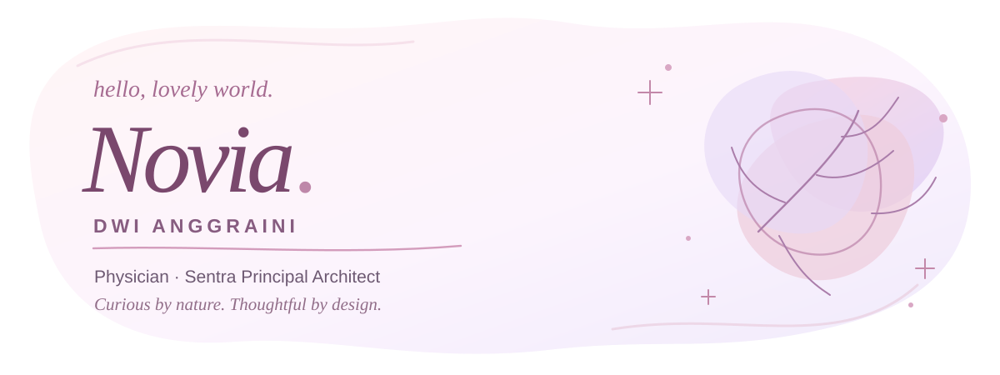
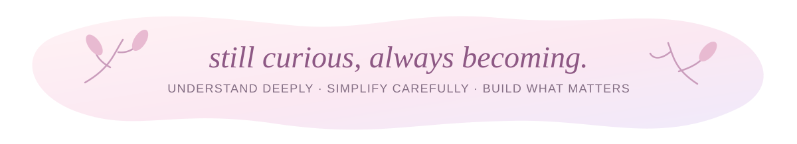

<!--
  Novia's GitHub profile README — soft editorial edition.
  A feminine, flowing composition made for GitHub's native Markdown renderer.
  No tables, grid cards, rectangular badges, or Mermaid boxes.
  Keep the assets/ folder alongside this README.md.
-->

  

  <em>Curious enough to explore. Practical enough to simplify.</em>

  <a href="https://github.com/noviaanggraini0511">GitHub</a>
  &nbsp; ✧ &nbsp;
  <a href="https://github.com/noviaanggraini0511/novsite">Portfolio source</a>
  &nbsp; ✧ &nbsp;
  <a href="#say-hello">Connect</a>

  

## ✿ A little about me

Hello, I'm **dr. Novia Dwi Anggraini** — a physician, **Sentra Principal Architect**, and independent explorer who finds joy in making complex things feel a little clearer.

I am curious, analytical, detail-oriented, and always interested in the *why* behind things. I enjoy discovering unfamiliar fields, experimenting with new ideas, and finding the structure hiding beneath a complicated problem.

My favorite kind of progress is the kind you can actually use: **a thoughtful decision, a clearer design, a more reliable system, or a simpler way forward.**

*Curiosity · Architecture · Experimentation · Craft · Clarity*

## ✿ What I do at Sentra

My work sits where product thinking, technical architecture, and practical judgment meet.

As **Sentra Principal Architect**, I focus on turning complex product and technical questions into clear boundaries, coherent systems, and paths that people can understand, inspect, improve, and trust.

For me, good architecture isn't about adding more structure. It's about knowing **which structure is necessary** — and making the next decision easier.

  <em>understand → notice what matters → simplify → build → verify → refine</em>

> “If a system becomes harder to explain after we've designed it, we may have added more complexity than value.”

## ✿ Selected work

A few pieces from my portfolio where visual judgment, systems thinking, and thoughtful execution meet.

### 01 / FORMA

*Brand & digital · 2026*

A quieter identity for a design-led workspace — made with intention, restraint, and care.

### 02 / NOMA

*Web & strategy · 2025*

Turning a complex service into a simpler, more welcoming path forward.

### 03 / ARC

*Product & UI · 2025*

A focused product system for teams that need clarity while moving quickly.

### 04 / FIELD NOTES

*Editorial & web · 2024*

An editorial experience built around curiosity, discovery, and meaningful details.

  <a href="https://github.com/noviaanggraini0511/novsite"><em>Explore the portfolio source ↗</em></a>

  

## ✿ The way I think

I believe clarity is something we *make*, not something we wait to find.

**01 · Notice the signal.** What is really happening, beneath all the noise?

**02 · Find the relationships.** Which parts of the system actually matter?

**03 · Respect the boundaries.** What belongs here — and what doesn't?

**04 · Choose the smallest sound path.** What can we simplify while keeping the result dependable?

**05 · Verify in reality.** Does the solution still make sense outside the diagram?

One idea keeps returning to me: **simplicity is the result of understanding, not a substitute for it.**

## ✿ What I bring to the table

**Depth of thought.** I like understanding the reasoning behind an answer, not only the answer itself.

**Adaptability.** New subjects make me curious. I learn by exploring, questioning, and trying things directly.

**An eye for detail.** I notice visual quality, structure, inconsistencies, and the small choices that shape a finished experience.

**Initiative.** When something can be improved, I enjoy finding a thoughtful way to move it forward.

**Practical judgment.** Ideas feel complete to me when they can become a useful decision or a real solution.

**A drive to grow.** I care about becoming a little better through every new challenge.

## ✿ The things I'm still learning

Having high standards is a strength, but I'm learning that **knowing when to stop is part of good judgment, too.**

I can overthink when several options seem equally reasonable. I sometimes refine details longer than the outcome needs, or keep exploring after there is already enough information to decide. Curiosity can create option overload; perfectionism can make finishing harder than starting.

These are reminders I carry into my work:

- Choose the details that truly change the result.
- Give exploration a clear stopping point.
- Make decisions with sufficient evidence, rather than waiting for perfect certainty.
- Ship, learn, and improve from what actually happens.

> “Good decisions don't require perfect information. They require enough understanding to move thoughtfully.”

## ✿ How I work & learn

I work best when the goal is clear and the path leaves room for independent judgment. My process is iterative: understand, organize, test something real, observe the details, and refine what matters.

I learn through **curiosity and contact**. I prefer experimenting with a concept, comparing alternatives, and seeing why something works rather than memorizing ideas in isolation.

I value communication that is direct but considered: clear reasoning, honest feedback, concrete examples, visible trade-offs, and room to ask *why?*

I try to avoid vague conclusions, hidden assumptions, unnecessary jargon, and confidence that hasn't been earned by evidence.

## ✿ A few principles I keep close

*Start with the real problem.*  
*Let the evidence shape the decision.*  
*Make assumptions and trade-offs visible.*  
*Keep boundaries clear.*  
*Design for reality, not just the happy path.*  
*Prefer useful structure over unnecessary machinery.*  
*Give good work a definition of done.*  
*Stay curious, and keep refining.*

  

## ✿ Say hello

I love thoughtful work, curious minds, well-considered design, and the moment a difficult problem finally becomes clear.

Find me on **[GitHub](https://github.com/noviaanggraini0511)**, or take a look at the **[portfolio source](https://github.com/noviaanggraini0511/novsite)**.

  

  dr. Novia Dwi Anggraini · Physician · Sentra Principal Architect · Independent Explorer

